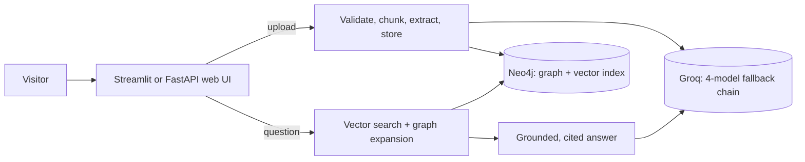

# Graph RAG: ask your documents

[](https://github.com/DoppalapudiYeshwanth/projects/actions/workflows/ci.yml)


Upload a document, ask questions about it, and get answers that **cite their sources** and show the
**knowledge-graph facts** behind them. It combines vector search with a Neo4j knowledge graph (GraphRAG) so it can
connect ideas across documents, not only find similar passages. Everything it runs on is free to use.

**Live demo:** none is deployed permanently. You can run it on your own machine in minutes, or share it temporarily
through a free tunnel; see [DEPLOYMENT.md](DEPLOYMENT.md) for every hosting route and what was verified about each.

## Features

- **Hybrid retrieval**: vector similarity (local `all-MiniLM-L6-v2` embeddings, Neo4j vector index) plus graph
  expansion over shared entities and relationships.
- **Structured extraction**: an LLM turns each chunk into validated entities and relationships (Instructor and
  Pydantic) from a closed vocabulary of 9 relationship types.
- **Free-tier resilience**: a four-model Groq fallback chain, a resumable cache and daily budgets keep it running
  within free quotas.
- **Private uploads**: `.txt`, `.md` and `.pdf` files go into a per-visitor workspace; one visitor cannot see
  another's documents.
- **Two front ends**, same engine: a Streamlit app and a FastAPI service with a plain-JavaScript page.
- **Tested**: 185 tests, 92% coverage, CI on every push.

## How it works



1. **Ingest**: a document is validated, split into 800-character chunks, and an LLM extracts entities and relationships.
2. **Store**: chunks, 384-dimension embeddings, entities and relationships are written to Neo4j with idempotent `MERGE`s.
3. **Retrieve**: the question is embedded; the 5 nearest chunks are found; shared entities and graph facts add context.
4. **Answer**: the model answers only from that context and cites chunk ids.

Design details, measured results and the decisions behind them are in [docs/ARCHITECTURE.md](docs/ARCHITECTURE.md).

## Results

| Benchmark | Result |
| --- | --- |
| 30 single-document questions, source found in top 5 | 96.7% (MRR 0.967) |
| 25 multi-hop questions, both sources found: plain vector search (5 chunks) | 80% |
| Same, vector search with the same chunk budget as the graph modes (7) | 84% |
| Same, `graph_hop` expansion | 84% |
| Same, `co_mention` expansion (default) | 92% |

The multi-hop gain over the same-budget baseline is 2 questions, and the question set was built from shared
entities, so treat it as suggestive. See the architecture document for the caveats.

## Tech stack

| Layer | Tools |
| --- | --- |
| Language | Python 3.12 recommended (3.10 minimum; 3.10 reaches end of life in October 2026) |
| LLM | Groq API (`gpt-oss-20b`, `gpt-oss-120b`, `qwen3.8-27b`, `gpt-oss-safeguard-20b`) |
| Structured output | Instructor, Pydantic v2, pydantic-settings |
| Embeddings | sentence-transformers (`all-MiniLM-L6-v2`), PyTorch |
| Database | Neo4j 5 (graph and vector index), official Python driver |
| Web | Streamlit; FastAPI, Uvicorn and vanilla JavaScript |
| Data | pandas, scikit-learn, langchain-text-splitters, pypdf |
| Quality | pytest, pytest-cov, Ruff, GitHub Actions, Dependabot |

## Quick start

You need Python, Docker (for Neo4j) and a free [Groq API key](https://console.groq.com/keys).

```bash
git clone https://github.com/DoppalapudiYeshwanth/projects.git graphrag && cd graphrag
python3.12 -m venv venv && source venv/bin/activate
pip install -r requirements-dev.txt          # exact tested versions: requirements.lock

docker run -d --name neo4j-graphrag -p 7474:7474 -p 7687:7687 \
  -e NEO4J_AUTH=neo4j/choose-a-password neo4j:5

cp .env.example .env                          # then set GROQ_API_KEY and NEO4J_PASSWORD
python -m scripts.check_setup                 # preflight: key valid? database reachable? prints Ready. when good
```

**Load the demo corpus** (400 arXiv abstracts; needs the data files, see the note below):

```bash
python -m scripts.prepare_corpus --per-category 100    # downloads the dataset into data/raw/corpus.csv
python -m scripts.build_graph --reset                  # extract, embed and load (resumable; uses Groq quota)
```

**Run it:**

```bash
streamlit run streamlit_app.py                         # Streamlit app on http://localhost:8501
# or
uvicorn graphrag.api:app --port 8000                   # FastAPI app on http://localhost:8000
python -m scripts.ask "How is homomorphic encryption used to protect biometric data?" --show-context
```

> `data/` is git-ignored. Rebuilding the demo graph from scratch takes a day on the free Groq tier because of
> per-model daily token limits; the cache in `data/processed/extractions.jsonl` makes reruns free. You can also skip
> the demo corpus and just upload your own documents.

## Configuration

Settings come from environment variables or `.env` (see `graphrag/config.py` for all of them).

| Variable | Purpose | Default |
| --- | --- | --- |
| `GROQ_API_KEY` | Groq API key (required) | none |
| `GROQ_MODEL`, `GROQ_FALLBACK_MODELS` | Primary extraction model and comma-separated fallbacks | `openai/gpt-oss-20b`, none |
| `ANSWER_MODEL` | Model that writes answers (separate quota) | the primary model |
| `NEO4J_URI`, `NEO4J_USERNAME`, `NEO4J_PASSWORD`, `NEO4J_DATABASE` | Database connection | `bolt://localhost:7687`, `neo4j`, required, `neo4j` |
| `EXPANSION_MODE` | `co_mention` or `graph_hop` | `co_mention` |
| `DAILY_ASK_BUDGET`, `DAILY_CHUNK_BUDGET` | Shared daily caps on questions and uploaded chunks | 150, 250 |
| `MAX_DOC_CHARS`, `MAX_DOCS_PER_WORKSPACE` | Upload limits | 15000, 5 |
| `API_KEY` | If set, the programmatic `/ask` endpoint requires `X-API-Key` | unset |

## Project layout

```
graphrag/            application package (config, data, models, graph, retrieval, ingest, api, streamlit_ui)
graphrag/static/     the plain-JavaScript page served by FastAPI
streamlit_app.py     Streamlit Community Cloud entry point
scripts/             build_graph, ask, evaluate, cleanup_workspaces, share_public.sh, ...
deploy/              streamlit_probe.py: checks whether a host can run the app before you commit to it
tests/               unit tests, web and UI tests, Neo4j integration tests
docs/ARCHITECTURE.md design brief
DEPLOYMENT.md        every hosting route, with what was verified
```

## Testing and CI

```bash
ruff check . && ruff format --check .
python -m pytest                                         # unit tests
docker run -d --name neo4j-test -p 7688:7687 -e NEO4J_AUTH=neo4j/testpassword neo4j:5
TEST_NEO4J_URI=bolt://localhost:7688 python -m pytest --cov --cov-fail-under=85
```

The integration tests wipe the database they connect to, so they only run against a throwaway instance and refuse
any database holding data they did not create. GitHub Actions runs lint, a syntax check, an import smoke test and the
full suite on Python 3.10 and 3.12 against a Neo4j service container, plus an advisory dependency audit.

## Security and privacy

- Visitors are isolated by workspace; isolation is covered by tests that fail if a scope filter is removed.
- Uploaded text is sent to Groq (a third party) for analysis and answering. Do not upload sensitive documents.
- There are no accounts: anyone with a workspace link or cookie can open that workspace.
- Report vulnerabilities privately; see [SECURITY.md](SECURITY.md).

## Limitations

The graph's benefit is unproven on single-document questions; the multi-hop benchmark is small; entities are matched
by exact normalised name; answering has no model fallback chain; free hosts sleep or restrict ports.
[docs/ARCHITECTURE.md](docs/ARCHITECTURE.md) lists them with their reasons.

## Contributing and license

Contributions are welcome; read [CONTRIBUTING.md](CONTRIBUTING.md) first (two rules: stay free to run, never leak
one visitor's data to another). Released under the [MIT License](LICENSE).
