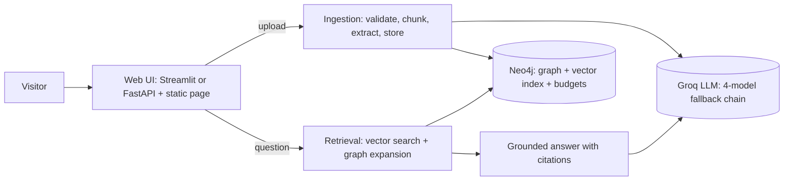

# Architecture and design decisions

A system-design brief for engineers and interviewers. Every number here was measured on this project; where
something is an estimate or untested, it says so.

## 1. Goals and constraints

| Goal | Consequence for the design |
| --- | --- |
| Answers grounded in the user's own documents, with citations | Retrieval-augmented generation; every passage has an id the model must cite |
| Connect facts across documents, not only find similar text | A knowledge graph next to the vector index (GraphRAG) |
| Anyone can upload a document without seeing anyone else's | Per-visitor workspaces with namespaced graph keys and scoped queries |
| **Zero running cost** | Free-tier LLM and database, local embeddings, hard daily budgets, no payment method anywhere |
| Survive provider limits | Four-model fallback chain, resumable cache, failure-rate guard |

## 2. System overview



| Module | Responsibility |
| --- | --- |
| `config.py` | One validated, frozen settings object (environment beats `.env` beats defaults) |
| `data.py` | Load, validate, stratified split, recursive chunking |
| `models.py` | Pydantic schemas, structured extraction, fallback chain, resumable cache |
| `graph.py` | Neo4j schema, idempotent writes, vector and exact search, workspaces, budgets |
| `retrieval.py` | Hybrid retrieval and grounded answering |
| `ingest.py` | Upload to private, searchable document, with progress events and rollback |
| `api.py`, `static/` | FastAPI routes and the plain-JavaScript page |
| `streamlit_ui.py`, `streamlit_app.py` | The same behaviour as a Streamlit page |

## 3. Data model

```
(:Document)-[:HAS_CHUNK]->(:Chunk {text, embedding[384]})-[:MENTIONS]->(:Entity {key, name, type})
(:Entity)-[:USES|APPLIED_TO|IMPROVES|PART_OF|EVALUATED_ON|BASED_ON|OUTPERFORMS|EXTENDS|RELATED_TO]->(:Entity)
(:Budget {id: "<kind>:<UTC date>", used})
```

- Entity-to-entity edges store `source_chunks`, the chunk ids that support them (provenance).
- The relationship vocabulary is **closed** (9 types). A validator maps free-form model output onto it; reversed
  verbs fall to `RELATED_TO` instead of being silently flipped.
- Uniqueness constraints on document, chunk, entity and budget ids make every write an idempotent `MERGE`.

Public corpus: 400 documents, 800 chunks, 3,961 entities, 4,649 mentions, 3,112 entity relationships.

## 4. Hybrid retrieval

1. **Vector search.** The question is embedded locally with `all-MiniLM-L6-v2` (384 dimensions, L2-normalised), so
   cosine similarity equals a dot product. Neo4j's HNSW index returns the top 5 chunks (the *seeds*).
2. **Graph facts.** Relationships touching entities mentioned in the seeds (up to 25).
3. **Expansion.** Two more chunks, chosen by shared entities. The default `co_mention` mode scores a candidate chunk
   *o* by how many rare entities it shares with the seeds:

$$
\text{strength}(o) \;=\; \sum_{e \,\in\, E(\text{seeds}) \cap E(o)} \frac{1}{\deg(e)}
$$

   where deg(*e*) is the number of chunks mentioning *e*. A rare shared entity is strong evidence of a real
   connection; a generic one is not. The alternative `graph_hop` mode follows entity-to-entity edges instead.
4. **Answer.** One prompt of numbered passages plus graph facts; the model must cite passage ids and may say the
   context is insufficient. Temperature 0.

Scores are comparable between the index and the exact scan because both use Neo4j's 0 to 1 cosine scale.

### Measured results

| Benchmark | Result |
| --- | --- |
| 30 single-document questions, hit@5 | **96.7%**, MRR 0.967; graph expansion adds nothing here |
| 25 multi-hop questions, both source documents found | vector@5 **80%**, vector@7 (same budget) 84%, `graph_hop` 84%, `co_mention` **92%** |

Read the multi-hop gain with care: the 8-point difference is **2 questions**, and the questions were built from
shared entities, which favours `co_mention` by construction. It is suggestive, not proven. A fair benchmark would
use independently written multi-hop questions and a held-out document set.

## 5. Extraction pipeline and the fallback chain

Each chunk goes to the LLM with a Pydantic schema; Instructor validates the reply and retries with the validation
error as feedback. **JSON mode** is used instead of tool calling because Groq validates tool calls server-side:
a missing field produced an HTTP 400 before any retry could happen. In JSON mode validation is local, so recovery works.

The chain is `gpt-oss-20b`, `gpt-oss-120b`, `qwen3.8-27b`, `gpt-oss-safeguard-20b` (`GROQ_MODEL` then
`GROQ_FALLBACK_MODELS`). Answers use a separate model (`ANSWER_MODEL`) so they draw on a different quota.

| Event | Response |
| --- | --- |
| 429, per-minute limit | Back off 5, 10, 20, 40, 80 s on the same model |
| 429, per-day limit (`(TPD)` in the message) | Move to the next model immediately |
| 404 `model_not_found` / `model_decommissioned` | Move to the next model |
| Validation failure | Instructor retries (3 times) |
| All models exhausted | `QuotaExhaustedError`; the batch stops cleanly and resumes from the cache |
| More than 10% of chunks fail (after 20) | Abort, so a broken run cannot look successful |

Three retry layers exist: the Groq SDK (short rate limits), Instructor (validation), and this loop. Instructor
wraps provider errors in its own exception, so rate-limit detection inspects `__cause__`. A long-running server
returns to the primary model after one hour, because daily quotas reset.

Measured cost: roughly 1,200 to 1,600 tokens per chunk, so a 200,000-token daily limit is about 120 to 170 chunks
per model. Whether Groq's windows are strictly rolling was not verified; the design does not depend on it.

## 6. Multi-tenancy and isolation

- A workspace id is 128 random bits (32 hex characters), held in an `HttpOnly` cookie (FastAPI) or the page URL (Streamlit).
- Uploaded nodes carry `workspace`; entity keys are prefixed `"<workspace>::<name>"`, so two visitors who mention
  the same concept never share a node.
- The public corpus is searched through the vector index. A private workspace is small, so it is scanned
  **exactly** with `vector.similarity.cosine`: an index query cannot filter by workspace and could miss a visitor's
  few chunks among 800 public ones.
- Every expansion query also filters by scope. Because namespaced keys already prevent leakage, this filter is
  defence in depth, and a test that creates deliberately corrupted cross-workspace links proves it holds.
- Workspaces are deleted on request and after `WORKSPACE_TTL_DAYS` idle days.

## 7. Cost and abuse controls

| Control | Mechanism |
| --- | --- |
| Shared daily caps | `Budget` nodes reserved with one atomic Cypher statement; refunds for work that did not happen |
| Rate limits | Per visitor and per address (in memory, so per process) |
| Size limits | Upload bytes, document characters, PDF pages, documents per visitor, concurrent uploads |
| No bill | No payment method on any service in the chain |

## 8. Decisions and the alternatives rejected

| Decision | Alternative | Why |
| --- | --- | --- |
| Neo4j for graph and vectors | Separate vector database | One store allows chunk-to-entity hops in a single query, with no cross-system joins |
| JSON mode | Tool calling | Local validation makes retries possible |
| Closed relationship vocabulary | Free-form types | 67 types appeared when unconstrained; a closed set keeps the graph queryable |
| Exact scan for private workspaces | Index with post-filter | The index cannot filter; small sets make exact search cheap and correct |
| Budgets in the database | In-memory counters | Survive restarts and multiple instances |
| Local embeddings | Hosted embedding API | No per-call cost, no extra data sharing |
| Local tunnel or Streamlit hosting | Cloud Run, Hugging Face Spaces | Cloud Run needs a billing account; Docker Spaces need a paid plan and block port 7687 (see `DEPLOYMENT.md`) |

## 9. Known limitations

- The graph's value is unproven on single-document questions; the multi-hop benchmark is small and biased.
- Entity linking is exact-match on a normalised name ("LLM" and "Large Language Model" stay separate).
- Answering has no model fallback chain.
- No authentication: possession of a workspace link is the credential.
- Uploaded text is processed by a third-party LLM provider.
- Free tiers can change; verify each provider's current terms before relying on them.

## 10. Questions this design should let you answer

1. *Why a graph as well as vectors?* Vector search finds similar passages; the graph connects passages that do not
   look alike but share entities, and records provenance. Measured benefit on single-document questions: none.
2. *How do you keep tenants apart?* Namespaced keys, scoped queries, exact private scans, and tests that break
   when any of those is removed.
3. *What happens when the LLM quota runs out mid-batch?* Fall through the chain, then stop cleanly; the cache makes
   the rerun free of repeated work.
4. *What would you build next?* Independent multi-hop evaluation, entity alias merging, an answer-path fallback chain.
